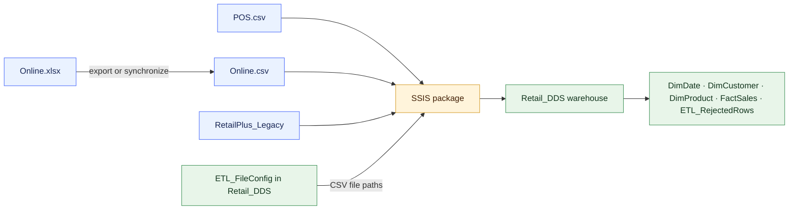
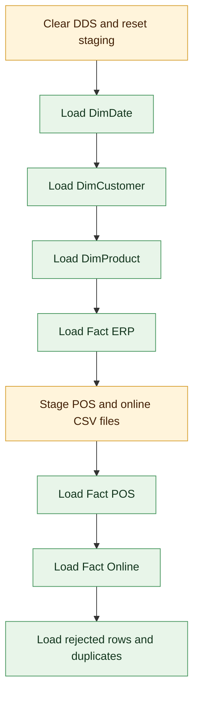

# Retail Sales ETL with SQL Server Integration Services

This project combines sales data from three systems—an enterprise resource planning (ERP) database, a point-of-sale (POS) CSV file, and an online-sales CSV file—into a SQL Server dimensional data store named `Retail_DDS`. The SSIS package stages and validates records, resolves source-specific customer and product identifiers, applies source priority to duplicate transactions, and records rejected or superseded rows.

The repository includes a small sample dataset with deliberately invalid and overlapping transactions. It is intended for learning and demonstration; the package performs a **full refresh** each time it runs.

## Contents

- [Project overview](#project-overview)
- [Architecture](#architecture)
- [Package workflow](#package-workflow)
- [Data model](#data-model)
- [Transformations and data quality](#transformations-and-data-quality)
- [Sample results](#sample-results)
- [Repository structure](#repository-structure)
- [Prerequisites](#prerequisites)
- [Setup and execution](#setup-and-execution)
- [Troubleshooting](#troubleshooting)
- [Scope and assumptions](#scope-and-assumptions)
- [Additional documentation](#additional-documentation)

## Project overview

| Area | Implementation |
|---|---|
| Orchestration | One SSIS package: `ssis/Package.dtsx` |
| Relational source | `RetailPlus_Legacy` SQL Server database |
| File sources | `data/POS.csv` and `data/Online.csv` |
| Online workbook | `data/Online.xlsx`, retained as the editable source/reference for the online CSV |
| Warehouse | `Retail_DDS` SQL Server database |
| Runtime file configuration | `Retail_DDS.dbo.ETL_FileConfig` |
| Rejection and duplicate log | `Retail_DDS.dbo.ETL_RejectedRows` |

The package reads `Online.csv` at runtime. It does not connect directly to the Excel workbook. If the workbook changes, export or update `Online.csv` to match it before executing the package.

## Architecture



## Package workflow



The sequence implements the transaction priority **ERP > POS > ONLINE**. The package loads ERP facts first, POS facts second, and online facts last. Each later source excludes transaction numbers already present in `FactSales`.

## Data model

The target database contains these tables:

| Table | Purpose |
|---|---|
| `DimDate` | Calendar attributes keyed by `DateKey` |
| `DimCustomer` | Customer code, name, and city |
| `DimProduct` | Product code, name, and category |
| `FactSales` | One accepted sales record per globally unique `TransactionNo` |
| `ETL_RejectedRows` | Rejected source records and lower-priority duplicate records, with a reason |
| `ETL_FileConfig` | Absolute paths to the POS and online CSV files used by `BULK INSERT` |

The fact table stores `Quantity`, `UnitPrice`, `GrossAmount`, `DiscountAmount`, `NetAmount`, `SourceSystem`, and foreign keys to the three dimensions. Its constraints require a positive quantity, nonnegative monetary values, a discount no greater than gross sales, and `NetAmount = GrossAmount - DiscountAmount`.

## Transformations and data quality

### POS source

- `SaleDate` is parsed from `dd/MM/yyyy`.
- `Price` is converted to a decimal after removing thousands separators such as commas.
- `Qty` must be a positive integer.
- `CustID` and `SKU` must resolve to customer and product dimension rows.
- `DiscountVND` is treated as a monetary amount.

### Online source

- `OrderDate` is parsed as an ISO date (`yyyy-MM-dd`).
- `BuyerCode` and `ItemCode` are translated through `CustomerMap` and `ProductMap` in `RetailPlus_Legacy`, then resolved against the warehouse dimensions.
- Only rows with `Status = Completed`, a nonblank `UnitPrice`, and a positive integer `Quantity` are loaded.
- `DiscountPct` is converted to a monetary discount using `ROUND(Quantity * UnitPrice * DiscountPct / 100, 2)`.
- The package reads this source from `data/Online.csv`, not from the `.xlsx` workbook.

### ERP source

- `ERP_Sales` is joined to the ERP customer and product master data through warehouse lookups.
- Only `Completed` transactions with a positive integer quantity are loaded.
- `InvoiceDate` supplies the fact date, and `DiscountMoney` is treated as a monetary amount.

Rows with invalid dates or quantities, blank required identifiers, cancelled status, missing mappings, or unresolved dimension keys are excluded from `FactSales` and recorded in `ETL_RejectedRows`. Unmatched SSIS Lookup rows are configured to use the no-match output so they do not terminate the entire package; the final logging task identifies excluded ERP rows from `ERP_Sales` and file-source rows from the staging tables.

Duplicate transactions are kept once according to the source priority. The lower-priority copy is written to `ETL_RejectedRows` with a duplicate reason.

## Sample results

The checked-in sample contains 16 rows in each of the POS and online sources and 16 ERP sales rows. Based on the sample data and package rules, the expected full-refresh outcome is:

| Result | Expected count |
|---|---:|
| Valid rows before cross-source deduplication | 37 |
| Rows loaded to `FactSales` | 29 |
| `FactSales` from ERP | 13 |
| `FactSales` from POS | 12 |
| `FactSales` from online | 4 |
| Invalid or cancelled rows | 11 |
| Lower-priority duplicate rows | 8 |
| Total rows in `ETL_RejectedRows` | 19 |

The duplicate totals include one online copy of `T012`, three online copies of `T014`–`T016`, and four online copies of ERP transactions `T022`, `T023`, `T025`, and `T026`. `T012` has different discount values in POS and online; the POS value is retained because POS has higher priority.

These are expected sample counts, not a report from an executed SSIS run.

## Repository structure

```text
Retail-ETL-SSIS/
├── data/
│   ├── Online.csv                 # Online file read by the package
│   ├── Online.xlsx                # Editable online source/reference workbook
│   └── POS.csv                    # POS source file
├── docs/
│   └── ETL-Design.md              # Mappings, validation, and sample-row details
├── sql/
│   ├── 00_source_ERP.sql          # Creates and seeds RetailPlus_Legacy
│   ├── 01_target_RetailDDS.sql    # Creates the target database and missing tables
│   └── 02_configure_file_paths.sql # Configures the two runtime CSV paths
└── ssis/
    ├── BI_TA2.slnx                # Visual Studio solution
    ├── BI_TA2.dtproj              # SSIS project
    ├── Package.dtsx               # Entry-point ETL package
    └── README.md                  # SSIS-specific setup notes
```

## Prerequisites

- SQL Server Database Engine with support for CSV `BULK INSERT` (SQL Server 2017 or later).
- SQL Server Management Studio (SSMS) to run the setup scripts.
- Visual Studio with the Integration Services Projects extension compatible with the project target. The checked-in project currently targets SQL Server 2025.
- Microsoft OLE DB Driver for SQL Server, referenced by the package as `MSOLEDBSQL.1`.
- A SQL Server instance that can access both CSV files. The identity used by the Database Engine to execute `BULK INSERT` must have read access to those files.

Microsoft documents CSV options and `BULK INSERT` requirements in the [BULK INSERT (Transact-SQL) reference](https://learn.microsoft.com/en-us/sql/t-sql/statements/bulk-insert-transact-sql?view=sql-server-ver17).

## Setup and execution

### 1. Create and seed the ERP source database

Open `sql/00_source_ERP.sql` in SSMS and execute it. The script creates `RetailPlus_Legacy` if needed, then drops and recreates its sample tables. **Rerunning it resets the ERP sample data.**

### 2. Create the warehouse schema

Execute `sql/01_target_RetailDDS.sql` in SSMS. It creates `Retail_DDS` and any missing warehouse tables, including the runtime file configuration table. It does not clear existing warehouse rows; the SSIS package performs the full refresh when it starts.

### 3. Configure CSV paths

Edit the sample absolute paths in `sql/02_configure_file_paths.sql`, then execute the script in SSMS. Use paths visible to the SQL Server Database Engine, such as a local path on the database server or an accessible share. The script stores them in `Retail_DDS.dbo.ETL_FileConfig`.

### 4. Configure the database connections

Open `ssis/BI_TA2.slnx` in Visual Studio. Review the `DDS_DST` and `ERP_SRC` OLE DB connection managers in `Package.dtsx`; both default to the `.\SQLEXPRESS` instance and use Windows integrated security. Change the server name if your SQL Server instance differs.

### 5. Execute the package

Run `Package.dtsx` from Visual Studio. The package checks that both CSV paths are configured before it clears warehouse data. Each execution then reloads the date dimension, customer and product dimensions, facts, and rejection log from the sample sources.

## Troubleshooting

| Symptom | Check |
|---|---|
| `BULK INSERT` cannot open a CSV file | Confirm the path in `ETL_FileConfig` and grant read access to the SQL Server Database Engine identity. A path on the client computer may not be visible to a remote database server. |
| Connection manager cannot connect | Confirm the SQL Server instance, database names, OLE DB Driver installation, and Windows login permissions. |
| A source row is absent from `FactSales` | Review `ETL_RejectedRows`, then check source status, date and quantity values, mapping tables, and dimension codes. |
| Expected counts do not match | Confirm that the package completed, both CSV files match the sample versions, and `Online.csv` was updated after any workbook changes. The package is a full refresh, so it clears and reloads the warehouse on each successful run. |

## Scope and assumptions

- The date dimension is generated for October 1–31, 2026.
- The supplied data assumes transaction numbers are globally unique across ERP, POS, and online systems.
- `FactSales` stores one row per transaction number. A production design that permits multiple product lines per receipt would need a line-level business key instead.
- The package is a full-refresh demonstration, not an incremental or change-data-capture pipeline.
- `Online.csv` must remain synchronized with `Online.xlsx` when the workbook is edited.

## Additional documentation

- [ETL design and source mappings](docs/ETL-Design.md)
- [SSIS project setup](ssis/README.md)
- [ERP source database script](sql/00_source_ERP.sql)
- [Warehouse schema script](sql/01_target_RetailDDS.sql)
- [CSV path configuration script](sql/02_configure_file_paths.sql)
